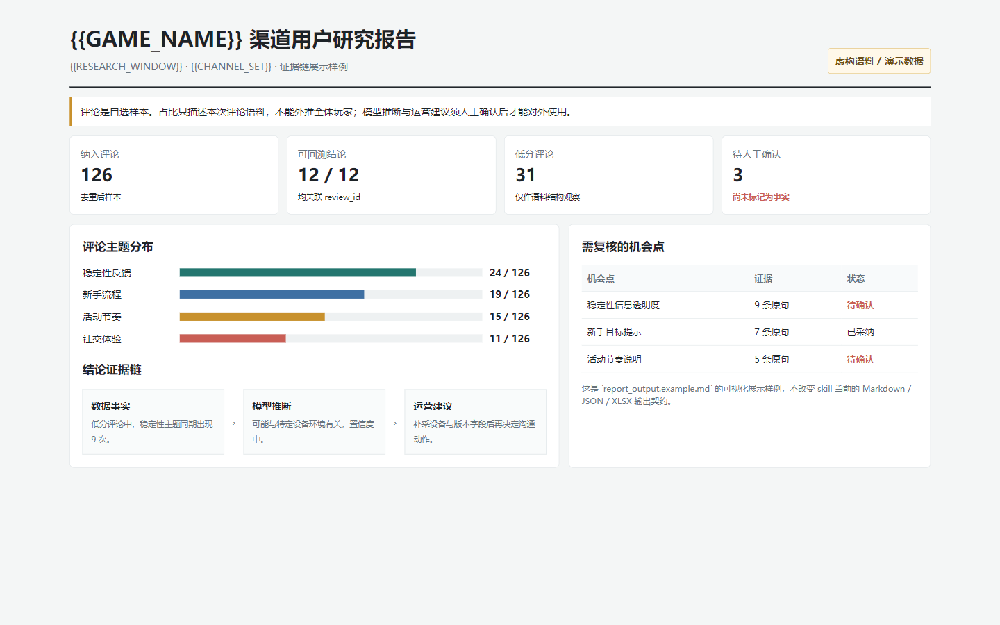
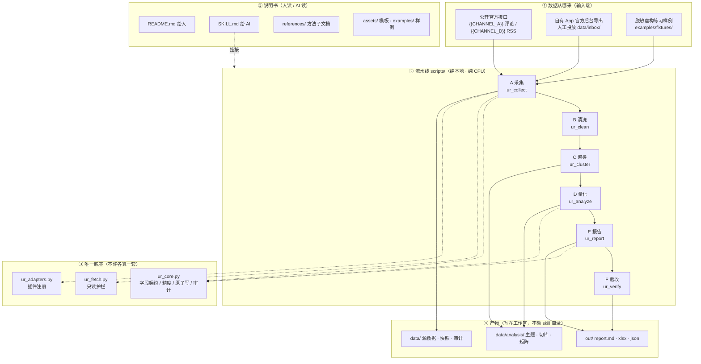

# channel-user-research：渠道用户研究

这个 Skill 将渠道指标和评论语料整理成可追溯的用户研究报告。README 面向使用者；AI 助手执行时读取同目录的 `SKILL.md`，两者分工见第 6 章。

仓库自带虚构练习数据。示例中的游戏、渠道、评论、评分和人员均为合成内容，不是真实玩家数据。默认验收流程离线运行，不需要账号或密钥。

> **场景模板**：`{{GAME_NAME}}`、`{{CHANNEL_A}}` 等字段是待配置占位符；fixture 中的数值与评论是确定性合成数据，只用于演示流程与验收，不代表任何游戏、平台、公司或客户。

分发版版本为 v1.0（2026-11-12）。离线验收无需账号或 API key；命令与安装路径使用相对写法。授权见 `LICENSE`，运行时依赖边界见 `THIRD_PARTY_NOTICES.md`。平台条款和账号操作由使用方负责，报告中的推断与建议必须经过人工确认。

## 报告预览

[打开完整 HTML 场景报告](examples/user-research-report.html)



HTML 将现有 Markdown 示例映射为可视化页面，不改变 Skill 当前的 Markdown、JSON 和 XLSX 输出契约。页面中的评论主题和指标均为虚构数据。

<!-- TOC -->
- [1. 用途](#1-用途)
- [2. 能帮你做什么 / 明确不做什么](#2-能帮你做什么--明确不做什么)
- [3. 5 分钟上手：一键离线试跑](#3-5-分钟上手一键离线试跑)
- [4. 项目架构](#4-项目架构)
- [5. 完整工作流：五阶段 15 步](#5-完整工作流五阶段-15-步)
- [6. 三份说明书怎么分工](#6-三份说明书怎么分工)
- [7. 数据契约：一表两型](#7-数据契约一表两型)
- [8. 采集层：渠道档位与四步法](#8-采集层渠道档位与四步法)
- [9. 精度诚实机制（防假精确）](#9-精度诚实机制防假精确)
- [10. 分层聚类与用户研究方法](#10-分层聚类与用户研究方法)
- [11. 防臆测：三段式报告与证据链](#11-防臆测三段式报告与证据链)
- [12. 输出物长什么样](#12-输出物长什么样)
- [13. 配置文件说明](#13-配置文件说明)
- [14. 依赖、安装与环境](#14-依赖安装与环境)
- [15. 怎么扩展：加渠道 / 换游戏 / 升级算法](#15-怎么扩展加渠道--换游戏--升级算法)
- [16. FAQ · 验收自检 · 残余风险 · 参考与致谢](#16-faq--验收自检--残余风险--参考与致谢)
<!-- /TOC -->

---

## 1. 用途

渠道数据通常分散在预约数、评分和评论中。这个 Skill 用固定流程完成采集、清洗、聚类、交叉分析和报告生成，并要求每条结论能够回溯到对应评论原文。

它把**手游渠道数值指标（预约数 / 评分 / 量级）的日常采集**里那套「精度不够就不硬算、算不出来就明说」的诚实规矩沉淀下来，再补上这类采集工作通常没有的评论分析、主题聚类、用户分层和运营建议。

它有三项主要设计：

| 设计 | 解决的问题 | 说明 |
|---|---|---|
| **唯一口径中心** | 数字在 Markdown、Excel、JSON 里各算一套，对不上 | 所有出口都从同一个地方取数，不会出现「报告说涨了、表格说跌了」 |
| **精度不倒退 + 原值入库** | 看着精确、其实是估算 | 采到多少写多少，一个系数不乘；变化小于最小刻度就写「—」，绝不填 0 冒充 |
| **三段式 + 证据链** | AI 一本正经地编 | 事实 / 推断 / 建议严格分开；每条洞察必须能回溯到 `review_id` + 逐字原句，查不到就整条丢掉 |

**谁该用**：渠道发行、运营、用研、做版本口碑复盘的人。你不需要懂代码——命令复制粘贴就行，配置里要填的东西都标了中文注释。

**触发方式**：在 AI 助手 里说「帮我做渠道用户研究」「分析这批玩家评论」「看看差评集中在哪」「做个版本口碑对比」「VOC 分析」「分层聚类」之类，助手会加载这个 skill。

---

## 2. 能帮你做什么 / 明确不做什么

### 能做

- **多渠道汇总**：预约数、评分、评论量、排名等数值指标，和玩家评论原文，统一进一张契约表
- **交叉分析**：例如「{{CHANNEL_A}} 评分 4.5 → 4.1」与「『闪退』主题在低分评论中占比上升」是否在同一时间窗出现
- **主题聚类**：把几百条评论自动归成几个主题，离群点单独放，不硬塞
- **用户分层**：按渠道、评分段、版本、时间窗、时长段、语言等切片看差异
- **痛点 / 机会点排序**：按「影响面 × 严重度 × 可行动性 × 商业价值」打分，权重公开、业务可一票否决
- **出运营动作**：每条动作带负责方、优先级、验证指标、原句依据
- **可追溯**：原始快照、sha256 指纹、append-only 审计日志，谁在什么时候确认了什么都有记录

### ⛔ 明确不做（不是"暂时没做"，是设计上拒绝）

| 不做的 | 为什么 |
|---|---|
| 给「全体玩家真实比例」 | 评论是自选样本，占比只代表**评论语料内部结构**，外推就是造假 |
| 实时舆情监控 / 自动发帖改状态 | 只读，绝不点会改变对方系统的按钮 |
| 登录他人账号、绕验证码 / 加密 / 风控、破解签名、代理轮换规避封禁 | 踩红线，整轮立即停止 |
| 抓包解密、逆向 App、要后台权限导别人数据 | 同上 |
| 口径估算 / 趋势插值 / 乘系数 / 5 分制与 10 分制合并算均分 | 精度不够就不硬算 |
| 写「因为」「导致」 | 只记录「同期出现」，不判断因果 |
| 硬套 RFM 分群 | 评论没有稳定用户 ID 和交易金额，套了就是假专业 |
| 申请外部大模型 API key | 主题命名和洞察交给**会话自带的 AI**，脚本不联网调模型 |

> 放宽采集规则不能替代官方接口。对于没有官方公开接口的渠道和应用商店，自动采集默认关闭，只保留人工导入入口。具体边界见第 8 章。

---

## 3. 5 分钟上手：一键离线试跑

**这是最快验证「装好了没有」的方式**：不联网、不装任何第三方库、不需要账号，用自带的虚构样例跑完整条链路。

### 第 1 步：在解压出来的文件夹里打开命令行

```bash
cd channel-user-research/scripts
```

（从解压后的父目录执行；Windows / macOS / Linux 都适用。）

### 第 2 步：跑一条命令

```bash
python run_pipeline.py --workspace ../../demo_output
```

（`../../demo_output` 是解压目录**旁边**的一个空文件夹，产物全写在那里，**不会改动技能包内任何文件**；这个文件夹可以随时删掉重来。命令里没有任何写死的路径，换台机器照抄即可。）

### 第 3 步：看屏幕上的验收结果

正常会看到：

```text
[OK] A 采集
[OK] B 清洗归一
[OK] C 轻量聚类
[OK] D 量化与交叉
[OK] E 三段式报告

=== 验收结果 ===
  PASS  1_三段式与声明
  PASS  2_交叉同期标记
  PASS  3_交叉矩阵与量化
  PASS  4_引用可定位
  PASS  5_指纹零改动
  PASS  6_红线与零联网

全部通过：True
```

**6 条全 PASS 才算跑通**，任一 FAIL 就看 `out/verification.json` 里那条的具体原因。

### 第 4 步：打开报告

```
<工作区>/out/report.md          ← 给人看的主报告
<工作区>/out/report.xlsx        ← 同口径的表格版（装了 openpyxl 才有）
<工作区>/out/report.json        ← 给下游系统
<工作区>/out/llm_brief.md       ← AI 主题命名任务包
<工作区>/out/pipeline-summary.json
<工作区>/out/verification.json  ← 验收明细
```

### 常用参数

| 参数 | 干嘛 | 默认 |
|---|---|---|
| `--workspace <目录>` | 产物写哪（`<目录>/data` 与 `<目录>/out`） | 当前目录下 `channel-user-research-demo` |
| `--out <路径>` | 兼容「直接给 out 路径」的写法，取其父目录当工作区 | — |
| `--config <文件>` | 你的 `channels.yaml`（离线可省略） | 内置离线配置 |
| `--project <文件>` | 你的 `project.yaml`（离线可省略） | 内置默认 |
| `--fixtures <目录>` | 练习样例目录 | `examples/fixtures/` |
| `--day YYYY-MM-DD` | 业务日期 | 今天 |
| `--n-clusters 5` | 聚几个主题 | 5 |
| `--no-brief` | 不生成 AI 命名任务包 | 生成 |
| `--live` | **联网真实采集**（默认关，开了要自己负责合规） | 离线 |

> 任一阶段失败会**立刻停并打印原因，不自动补救**——这是故意的，免得悄悄用估算值把窟窿补上。

---

## 4. 项目架构

整个 Skill 分为五层：数据从左侧进入，经处理流程后输出结果；公共契约负责字段和精度，参考文档分别说明各阶段的执行方法。



### 目录树（每个文件干嘛）

```text
channel-user-research/
├── SKILL.md                      ← 【AI 读的唯一入口】触发词、8 条铁律、五阶段挂接
├── README.md                     ← 【你正在读的】给人看的完整说明书
├── requirements.txt              ← 依赖白名单 + 「明确不装」清单
├── LICENSE                       ← 授权与分发声明（MIT）+ 数据/合规声明
│
├── scripts/                      ← 能跑的代码（纯 Python）
│   ├── run_pipeline.py           ← 一键串起 A→F，第 3 章那条命令就是它
│   ├── ur_core.py                ← 唯一数据契约、精度量纲、原子写、不倒退 upsert、审计、指纹
│   ├── ur_fetch.py               ← 只读请求层：仅 GET/HEAD、禁带登录态、四步法探测
│   ├── ur_adapters.py            ← 按配置动态加载渠道适配器（不硬编码白名单）
│   ├── ur_collect.py             ← A 采集编排：红线预检、正常缺数、收尾重尝试、日期护栏
│   ├── ur_clean.py               ← B 清洗：三态校验、去重脱敏、先定切片
│   ├── ur_cluster.py             ← C 聚类：sklearn 优先 / 标准库兜底 + AI 命名任务包
│   ├── ur_analyze.py             ← D 唯一量化中心：占比、五套交叉、机会点排序
│   ├── ur_report.py              ← E 唯一口径出口 build_rows()、三段式渲染、静态断言
│   └── ur_verify.py              ← F 6 条验收 + 负向用例 + 红线静态断言 + sha256
│
├── references/                   ← 方法子文档（AI 按需读，不必通读）
│   ├── data-schema.md            ← 动手前必读：字段字典、精度量纲、分母口径
│   ├── redlines.md               ← 动手前必读：10 条红线、本档放宽边界、渠道默认状态
│   ├── collection-playbook.md    ← 网页四步法、扫不到≠没有、命中纪律、缺口填补
│   ├── analysis-playbook.md      ← 三层分层、五套交叉矩阵、机会点公式
│   ├── anti-hallucination.md     ← 防臆测 10 护栏、grounding check、人工确认 gate
│   ├── channel-adapters.md       ← 配置字段表、加渠道 5 步、适配器契约
│   └── env-and-risks.md          ← Windows 坑、依赖说明、残余风险
│
├── assets/                       ← 空模板（占位符，交付前替换）
│   ├── report_template.md        ← 三段式报告模板
│   ├── llm_prompt_template.md    ← 让 AI 起主题名的提示词模板
│   └── audit_log_template.csv    ← 审计记录模板
│
└── examples/                     ← 可直接照抄的样例
    ├── channels.example.yaml     ← 【加渠道唯一要改的那份】
    ├── project.example.yaml      ← 项目参数（游戏代号、时间窗、权重）
    ├── fixtures/                 ← 脱敏虚构练习数据（离线闭环就靠它）
    │   ├── generate_fixtures.py  ← 生成脚本，random.seed(20261112) 可复现
    │   ├── metrics_sample.csv    ← 24 行数值
    │   ├── reviews_sample.jsonl  ← 72 条评论
    │   ├── raw_snapshot_sample.json
    │   └── expected_summary.json ← 验收期望断言
    ├── llm_brief.example.md      ← AI 命名任务包填好的样子
    └── report_output.example.md  ← 一份完整报告的成品样例（20KB）
```

**关键设计**：`scripts/` 里的代码只依赖 `ur_core.py` 这一份契约；所有出口（md / xlsx / json）只消费 `ur_report.py::build_rows()` 的结果。改字段必须同步改契约 + 报告 + fixtures + 重跑验收，清单写在 `references/data-schema.md` 开头。

---

## 5. 完整工作流：五阶段 15 步

流程从左到右推进，每一步都有明确的拒绝条件，用来阻止缺少证据或口径不一致的结论进入报告。


### 每步在防什么

| 阶段 | 步骤 | 关键护栏（人话） |
|---|---|---|
| **A 采集** | A1 | 开工先查红线；`--offline` 下**任何联网动作直接报错** |
| | A2 | 判断「网页到底有没有数」必须走完四步：页面文字 → 内嵌数据块 → 页面 JS 引用的公开接口 → 都没才判死；任何「没数」结论要写明做到第几步 |
| | A3 | 数值进 CSV、评论进 JSONL，各走各的；原始响应留快照 |
| | A4 | 0 条要告警（空 ≠ 没有）；「扫不到 ≠ 没有」先确认扫描完整；收尾对异常渠道冷却后各给一次机会；**只允许回填今天**，历史日期一律拒绝；重跑时精度不倒退 |
| **B 清洗** | B5 | 三态校验（正常 / 告警 / 错误），存疑数据隔离，不硬塞 |
| | B6 | 逐字原句不改写；`raw` 可脱敏；没有的值归「未指明」桶，不静默丢 |
| | B7 | **先定切片再聚类**，防「先聚完类再回头找差异」的自欺 |
| **C 聚类** | C8 | 中文用字符 n-gram，纯 CPU；装了 sklearn 走 `char_wb 2-4 + KMeans`，没装走标准库兜底，**零第三方依赖也能跑** |
| | C9 | 离群点固定 `-1` 单列，不强行归到某个主题 |
| | C10 | `--emit-brief` 生成 `out/llm_brief.md` 任务包，交给**会话自带 AI** 起主题名；脚本不调外部 API、不要 key |
| **D 量化** | D11 | 每条洞察回查 `review_id` + 原句，查不到**整条丢弃并写审计** |
| | D12 | 每个百分比带绝对条数和分母类型；`n<20` 只给方向；`20≤n<50` 标「仅供参考」；永不给两位小数 |
| | D13 | 五套交叉矩阵；评分变化与主题上升只写「同期出现」；机会点权重显式列出、业务能否决 |
| **E 报告** | E14 | 三段式：数据事实 / 模型推断 / 运营建议；推断混进事实段即**拒绝出报告** |
| | E15 | 唯一口径出口；append-only 审计；跑前跑后 sha256 比对，确保 skill 目录和 fixtures 零改动 |
| **F 验收** | 6 条 | 三段式与声明、交叉同期标记、矩阵量化、引用可定位、指纹零改动、红线与零联网 |

> 📖 完整 15 步护栏在 `references/collection-playbook.md` 和 `references/analysis-playbook.md`；`SKILL.md` 只挂接、不复制正文。

---

## 6. 三份说明书怎么分工

说明文件分为三层，每层只维护自己的内容，避免同一规则在多处复制后产生冲突。

| | 给谁读 | 回答什么 | 写法 |
|---|---|---|---|
| `SKILL.md` | **AI 助手**（执行时读） | 什么话触发、按哪 8 条铁律走、哪一步读哪个子文件、调哪个脚本 | 命令式、精简、只挂接不复制正文、全相对路径 |
| `README.md` | 使用者和维护者 | 用途、运行方式、输出、设计原因与问题定位 | 业务说明、图示、示例和 FAQ |
| `references/*.md` | AI 在**特定阶段**按需读 | 该阶段的完整方法、边界、反例 | 一份只管一件事 |

**渐进式披露**：AI 平时只看 `SKILL.md`；到了「判断网页有没有数」才去翻 `collection-playbook.md`；到了「让 AI 起主题名」才去翻 `anti-hallucination.md`。这样既不让主文件变成几十 KB 的砖头，也不会漏掉关键护栏。

**什么时候读哪份**（`SKILL.md` 里也有一张同样的表）：

| 场景 | 读哪份 |
|---|---|
| **动手前** | `data-schema.md`（字段契约）、`redlines.md`（合规边界） |
| 阶段 A 采集 / 判断网页有没有数 | `collection-playbook.md`、`channel-adapters.md` |
| 阶段 C/D 分层、交叉、机会点 | `analysis-playbook.md` |
| 让 AI 起主题名、写洞察、人工确认 | `anti-hallucination.md`、`assets/llm_prompt_template.md` |
| 出报告 | `assets/report_template.md` |
| 装依赖、排 Windows 报错、看风险 | `env-and-risks.md` |
| 加渠道 | `examples/channels.example.yaml` + `channel-adapters.md` |

---

## 7. 数据契约：一表两型

数值记录和评论记录共用公共字段，通过 `record_type` 区分类型。这样做交叉分析时不需要临时拼接两套口径不同的表。

### 一个契约、两类行、三份文件

| | 说明 |
|---|---|
| 一个契约 | `record_type = metric`（数值）或 `review`（评论），共用 18 个公共字段 |
| 两类行 | 数值 → 长表 CSV（一行 = 一天一渠道一指标，`utf-8-sig`）；评论 → JSONL（一行一条原文，append-only） |
| 三份源文件 | `data/metrics.csv`、`data/reviews.jsonl`、`data/snapshots/**`（原始响应副本）。**其余全是派生结果，可随时重算** |

**对齐钥匙**：`channel_key + 时间窗 + app_version`。数字和评论靠这把钥匙贴到同一个切片上，才能做「评分下滑 ↔ 差评主题上升」的交叉。

### 公共 18 列（定稿，不轻易增删）

| 字段 | 说明 |
|---|---|
| `record_id` / `record_type` | 这行的唯一编号 / 是数字还是评论 |
| `game_key` | 游戏代号，**不写死具体游戏名**——这是能迁移到别的项目的关键 |
| `channel_key` / `channel_name` | 渠道代号 / 展示名 |
| `day` / `captured_at` | 业务日期 / **真实采集时刻**（补录必须标真实时刻，不许假装当场采到） |
| `source` / `source_url` / `snapshot_path` | 从哪来 / 公开地址 / 原始副本路径（证据链） |
| `status` | `ok` / `failed` / `skipped`，失败和跳过都要带理由 |
| `precision` | **最小可分辨单位**（数值量纲，见第 9 章） |
| `raw` / `warn` / `error` / `note` | 原始值（一系数不乘）/ 告警不拦数据 / 错误拦数据 / 业务备注 |
| `ingest_batch` / `compliance_tag` | 批次号 / 合规标记（`public_anonymous` 或 `manual_confirmed`） |

### 数值专用 4 列

`metric_key`（预约数/评分/评论数/排名/好评率）、`metric_value`（**禁止填 0 冒充没数**）、`metric_unit`、`metric_kind`（`outer` 外显值 / `real` 回传真值，**两类不可混着看、更不可混加**）。

### 评论专用 16 列

`review_id`（**引用定位唯一锚点**）、`review_text`（**逐字原句，不改写/不摘要/不翻译**）、`rating` / `rating_max`（5 分制与 10 分制分开存）、`review_time`、`app_version`、`playtime_hours`、`lang` / `country`、`votes_up`、`developer_replied`、`is_early_access`、`labels`（一条评论允许多标签）、`topic_id`（离群点固定 `-1`）、`topic_confidence`（明确标为推断）、`evidence_kind`（三段式标记）。

> 完整字段表、脱敏与原始副本的取舍、列结构定稿声明见 `references/data-schema.md`。**改字段 = 改契约**，必须同步改 4 处并重跑验收。

---

## 8. 采集层：渠道档位与四步法

### 最终合规档位：自有账号 + 自有 App 官方接口

这是相对既有渠道采集红线**唯一显式放宽**的一档，其余 10 条红线全部保留：

| 允许 | 禁止 |
|---|---|
| 公开匿名可见数据（{{CHANNEL_A}} 公开评论接口、{{CHANNEL_D}} 公开 RSS） | 抓包解密、逆向、绕验证码/加密/风控、破解签名 |
| **自己 / 团队名下账号**的登录态 | 登录**他人**账号 |
| **自有 App** 的官方后台接口（{{OWNED_CHANNEL_BACKEND}} `{{OWNED_REVIEW_METHOD_A}}`、{{OWNED_CHANNEL_API}} `{{OWNED_REVIEW_METHOD_B}}`、各商店自有后台导出） | 代理轮换规避封禁、点任何改变对方系统状态的按钮 |
| 人工投放公开匿名可见的导出数据 | 不走「申请后台权限 + 手动导出别人数据」 |

自有账号操作由**账号持有人本人**执行，须标 `manual_confirmed` 并在 `note` 带填写人，平台条款责任由使用方承担。

### 各渠道默认状态（`channels.example.yaml`）

| 渠道 | 默认 | 方式 | 说明 |
|---|---|---|---|
| {{CHANNEL_A}} 公开评论 | **开** | `official_api` | 官方公开接口，只读、游标分页、429 即停 |
| {{CHANNEL_D}} 公开评论源 | **开** | `public_html` | 强制 `runtime_probe: true` + 空结果告警（近年有空返回争议） |
| 自有 App · {{OWNED_CHANNEL_BACKEND}} | 关 | `manual_import` | 确认是自己名下 App 再开，需人工确认 |
| 自有 App · {{OWNED_CHANNEL_API}} | 关 | `manual_import` | 同上；不碰 {{CHANNEL_E}} 页面与第三方内部 RPC 库 |
| {{CHANNEL_B}} / {{CHANNEL_C}} | **关** | `manual_only` | 无官方接口 / 条款风险，**只走人工投放** |
| {{CHANNEL_E}} 页面 | **硬禁用** | `disabled` | 服务条款禁止自动化访问 |

> 未显式 `enabled: true` 的渠道一律关；`empty_result_is_alert: true`（0 条 ≠ 没有，必须告警）；`enabled_default: false`。

### 网页四步法（判断「到底有没有数」，不能只看渲染出来的字）

1. 看页面渲染出来的文字
2. 翻内嵌数据块（`__INITIAL_STATE__` / `__NEXT_DATA__` / `__NUXT__`）
3. 找页面 JS 引用的公开接口
4. 以上都没有，才判「没数」

> **任何「没数」结论必须写明做到第几步**。只看渲染文字就下结论，很容易把能拿到数的渠道误判成「网页不给数」，白费工夫。

### 三条命中纪律（从渠道采集实践里提炼）

- **扫不到 ≠ 没有**：先确认扫描本身完整（按「整个目录」挑文件曾把某安卓应用商店的 `files/` 整个漏掉，误判「到头了」，改成按单文件挑后翻案）
- **先看接口给的是整数还是字符串**：`currentCount: 1527998` 能扫精确值；`"93.3万人已预约"` 或 protobuf 二进制，源头就没有精确值，扫到底也不会有
- **要「唯一命中」，不是「落在区间内」**：必须限制在包名/标识附近（±5000 字符），否则会把别的游戏图片链接里的数字片段当成命中

完整版（含正常缺数白名单、收尾重尝试六条边界、`can_write_back` 日期护栏、缺口填补准则）见 `references/collection-playbook.md` 与 `references/redlines.md`。

---

## 9. 精度诚实机制（防假精确）

精度不足时不计算增量；无法计算时明确标注原因。报告不能用精确的小数掩盖估算或缺失数据。

### `precision` 是数值量纲，不是标签

| `precision` 值 | 含义 | 能算增量吗 |
|---|---|---|
| `1` | 个位精确（人） | 能 |
| `1000` | 万级一位（±500） | 否，只看趋势 |
| `10000` | 万级整数（±5000） | 否，只看量级 |
| `0.1` | 评分一位小数 | 能 |

**铁律**：`abs(变化量) < precision` → 变化写「—」，**绝不写 0**。由 `build_rows()` 统一执行，任何下游出口都不许自己算。

> 「口径 ≠ 精度」：外显值 / 回传真值（`metric_kind`）与 `precision` 是正交两维，报告里分两列写。

### 防假精确 10 条

1. 原值入库，一个系数不乘；不做口径估算 / 推算 / 按趋势插值
2. 不可比数据禁止聚合（5 分制与 10 分制不合并算均分、不换算）
3. 变化小于最小刻度写「—」，**绝不填 0**；0 只用于分组计数
4. 每个百分比必须带**绝对条数 + 分母类型**，三者不可混用：占全量评论 / 占该渠道评论 / 占该评分段评论
5. `n < 20` 不给百分比，只写「方向性：6/14（样本不足，仅供参考）」
6. `20 ≤ n < 50` 标「仅供参考」；`n ≥ 50` 才给一位小数
7. **永不给两位小数**；舍入差不做配平、不估算
8. 空结果一律告警（0 条 ≠ 没有），`failed` / `skipped` 都带理由
9. 重跑时**精度不倒退**：同键重采，若旧值更精确就保留旧值并备注留痕
10. 评论占比只代表**评论语料内部结构**，不能外推全体玩家比例——报告顶部固定声明

> 不同分母要分别判断：同一个数字，在「占该渠道评论」里可能样本充足，在「占 W1 低分评论」里可能样本不足。样例报告里 `6/14（样本不足）` 与 `71%（15/21，仅供参考）` 并存，就是因为**组级分母和窗口级分母分别判定**，不是算错。

---

## 10. 分层聚类与用户研究方法

### 轻量本地 + AI 大脑（为什么这么选）

| 方案 | 为什么不选 |
|---|---|
| 全套大模型 / 重型主题建模方案 | 要 GPU 或拉取多项编译依赖，Windows 上冲突高发；还可能需要 API key |
| 纯规则关键词 | 换个游戏就得重写词表，新主题发现不了 |
| **本方案** | **纯 CPU 本地聚类 + 会话自带 AI 起名字/写洞察**。零 GPU、零外部 key、离线可跑 |

聚类实现：优先 `scikit-learn` 的 `TfidfVectorizer(analyzer="char_wb", ngram_range=(2,4)) + KMeans`；**没装 sklearn 就自动走纯标准库字符 n-gram TF-IDF + KMeans 兜底**，保证零第三方依赖也能闭环。离群点 `topic_id = -1` 单列，不强行命名。

### 三层分层（别混层）

| 层 | 切分维度 | 性质 |
|---|---|---|
| 结构层 | 渠道 / 版本 / 时间窗 / 评分段 / 游玩时长 / 语言 | 客观，最可靠，事实段全基于这层 |
| 态度层 | 情感倾向 / 诉求类型 | **推断**，只出现在第二段，须标「需人工确认」 |
| 行为层 | 评论影响力 / 参与度 / 时长 | 缺字段就不出结论，明说「算不出来」 |

> ⛔ **不硬套 RFM**：评论没有稳定用户 ID，也没有交易金额，RFM 会退化。用「影响力 + 参与度 + 时长」三轴更诚实。

### 五套交叉矩阵

渠道 × 主题、评分段 × 主题、时间窗 × 主题、版本 × 主题、时长段 × 主题。**三张主矩阵的分母互不相同，表头标明分母类型，绝不可混用**。

### 措辞纪律：只写「同期出现」

```
可用表述：「{{CHANNEL_A}} 公开评论」评分 4.5 → 4.1，与「闪退/崩溃/掉线」主题在低分评论中占比上升。
   同期出现（W1 方向性：6/14（样本不足，仅供参考） → W2 71%（15/21，仅供参考）；同期出现，非因果）
不可用表述：「因为闪退变多，导致评分下滑」。
```

### 机会点排序（权重公开，业务可一票否决）

```
机会分 = 0.35×影响面 + 0.30×严重度 + 0.20×可行动性 + 0.15×商业价值
```

| 维度 | 权重 | 说明 |
|---|---|---|
| 影响面 | 0.35 | 命中评论条数占比 |
| 严重度 | 0.30 | 是否阻断进入 / 游玩 / 付费 |
| 可行动性 | 0.20 | 团队能不能改、改动大不大 |
| 商业价值 | 0.15 | 与预约 / 评分 / 付费的关联 |

权重写在 `project.yaml`，会**原样写进报告**；任一维度业务判定不达标，该机会点直接出局或重排，不按分数硬排。

方法全貌（主题分析六步法、亲和图、三角验证、persona、影响力-工作量矩阵、JTBD、量化 10 纪律）见 `references/analysis-playbook.md`。

---

## 11. 防臆测：三段式报告与证据链

报告将数据事实、模型推断和运营建议分开，并要求每条模型结论都能回溯到评论原文。

| 段 | 允许出现什么 | 谁产生 |
|---|---|---|
| **一、数据事实** | 原值、条数、分母、可直接核对的同期变化 | 脚本 |
| **二、模型推断** | 主题名、纳入/排除标准、置信度、聚类结果 | 聚类 + AI 命名，**永远带「需人工确认」** |
| **三、运营建议** | 优先级、负责方、验证指标、动作 | AI + 人工确认 |

**硬机制**：

- `ur_report.py` 有**静态断言**：推断段内容（置信度、模型推断、建议、待 AI 命名）出现在事实段 → **拒绝出报告**；全文不得出现「导致」「因为」、两位小数百分比、`0.0%`
- **Grounding check**：每条洞察必须能回溯 `review_id` + 逐字原句；查不到即**整条丢弃并写审计**，不改写、不摘要、不翻译、不补写
- **主题不靠漂亮名字**：每个主题要有显式纳入标准、排除标准、3–5 条代表原句、至少 1 条反例 non-matches、score rationale
- **人工确认 gate**：AI 输出在人接受前永远是「建议」；确认记录（采纳 / 驳回 / 改标准）写进 `out/audit_log.csv`
- **append-only 审计**：`data/audit/append-only.jsonl` 只追加，记录时间 / 批次 / 动作 / 触发人 / 输入输出指纹 / 是否人工确认
- **sha256 指纹**：跑前跑后比对，确保 skill 目录与 fixtures 零改动，只有 `out/` 新增

> 完整防臆测 10 护栏见 `references/anti-hallucination.md`。

---

## 12. 输出物长什么样

| 产物 | 给谁 | 位置 |
|---|---|---|
| `report.md` | 运营 / 发行 | `<工作区>/out/` |
| `report.xlsx` | 需要表格的人（装了 openpyxl 才有） | 同上 |
| `report.json` | 下游系统 | 同上 |
| `matrix.csv` / `topics.json` / `slices.json` / `insights.json` | 复核者 | `<工作区>/data/analysis/` |
| `llm_brief.md` | 会话 AI（起主题名用） | `<工作区>/out/` |
| `append-only.jsonl` | 审计 | `<工作区>/data/audit/` |
| `snapshots/**` | 复核者（脱敏后 + 哈希指纹） | `<工作区>/data/snapshots/` |
| `verification.json` | 验收 | `<工作区>/out/` |

### 报告开头（真实跑出来的样子）

```markdown
# 渠道用户研究报告

> **必读声明**：评论是自选样本，占比只代表评论语料内部结构，不能外推全体玩家比例

本报告分三段呈现，三段之间不混用；后两段的结论要经过人工确认才能对外使用。

## 一、数据事实

| 渠道 | 日期 | 指标 | 口径 | 数值 | 精度 | 可信度 | 变化 |
| --- | --- | --- | --- | --- | --- | --- | --- |
| {{CHANNEL_A}} 公开评论 | 2026-10-01 | rating | 外显值 | 4.5 | 0.1 | 精确·可算增量 | — |
| {{CHANNEL_A}} 公开评论 | 2026-10-28 | rating | 外显值 | 4.1 | 0.1 | 精确·可算增量 | -0.2 |

| channel | channel_c_manual | T01 | 7 | 24 | 29%（7/24，仅供参考） | — |
```

**注意每个百分比都带着 `7/24` 这样的绝对条数和分母**，且 `仅供参考` 标出来了。

📄 **完整成品样例**：`examples/report_output.example.md`（20KB，含主题清单、离群点、人工确认记录、机会点排序、动作清单、异常区、结论后核查追问、自检清单）。空模板见 `assets/report_template.md`。

### 离线样例跑出来的实际结论

聚类用标准库兜底分出 5 个主题，`T01` 是「闪退/崩溃/掉线」，代表句「闪退掉线崩溃三连，这个版本稳定性太差」；交叉信号成功识别：

> 「{{CHANNEL_A}} 公开评论」评分 4.5 → 4.1 与「闪退/崩溃/掉线」主题在低分评论中占比上升**同期出现**（……；同期出现，非因果）

`grounding: all_locatable=True`，6 条验收全 PASS。

---

## 13. 配置文件说明

`examples/` 中的两份 `.example.yaml` 是配置模板。请复制到自己的工作区后修改，不要直接覆盖 Skill 目录中的模板。

### `channels.yaml` —— 加渠道唯一要改的那份

```yaml
version: 1
defaults:
  rate_limit_qps: 0.3          # 全局频率上限，克制优先
  max_pages: 5
  page_size: 100
  retry_on: [429, 500, 502, 503, 504]   # 只对 5xx/429 退避
  snapshot: true                # 原始响应留副本
  redact_pii: true              # 脱敏默认开
  enabled_default: false        # 未显式 enabled 的渠道一律关
  empty_result_is_alert: true   # 0 条 ≠ 没有，必须告警

channels:
  - key: channel_a_reviews
    name: {{CHANNEL_A}} 公开评论
    enabled: true
    mode: official_api
    adapter: public_json_api
    entry: "https://api.example.invalid/reviews"
    params: { game_id: "<填 game_id>", ... }
    reviews:
      id_field: recommendationid
      text_field: review
      playtime_field: author.playtime_at_review   # 支持点路径
    compliance:
      compliance_tag: public_anonymous

slices: [channel, rating_band, version, time_window, playtime_band, lang]
```

字段全表、适配器 5 方法契约见 `references/channel-adapters.md`。

### `project.yaml` —— 项目级参数（换游戏只改这里）

| 配置块 | 关键项 |
|---|---|
| 基本 | `game_key`、`display_name` |
| `time_windows` | **必须两个等长时间窗**（W1/W2），单点不给趋势结论 |
| `privacy` | `redact_pii: true`（快照脱敏，评论原句仍逐字保留） |
| `report` | `audience`、`include_pii: false`、`causal_wording: forbidden`、固定声明 |
| `analysis` | `n_clusters: 5`、`small_sample_threshold: 20`、`indicative_threshold: 50`、`outlier_topic_id: -1` |
| `opportunity_weights` | `impact 0.35 / severity 0.30 / actionability 0.20 / business_value 0.15`（合计 1.0，业务可改） |
| `verification` | grounding check、禁两位小数、禁填 0 冒充、sha256 前后比对 |

> 没装 PyYAML 时，`--project` 会被忽略并提示，自动用内置默认配置——**离线闭环不依赖任何第三方库**。

### `examples/fixtures/` —— 练习数据

`generate_fixtures.py` 用 `random.seed(20261112)` 固定随机种子，生成 3 渠道 × 2 等长时间窗、24 行数值 + 72 条评论，主题为 crash / visual / gameplay / payment / service，并**故意埋了「评分下滑 + 闪退主题上升」的信号**，用来验证交叉分析真的能跑出来。`expected_summary.json` 是验收期望断言。

---

## 14. 依赖、安装与环境

### 安装位置

**用户级技能**：放到 `{{SKILL_ROOT}}/channel-user-research/`。
换机器时，把**本压缩包**解压，把里面的 `channel-user-research/` 整个文件夹放进这个目录即可，无需改任何配置。

### 零依赖就能跑（重要）

**离线闭环不依赖 `PyYAML` / `pandas` / `scikit-learn` / `openpyxl` 中的任何一个**。装了它们会自动增强（聚类更好、能出 Excel、能读 yaml），没装也照常跑通 6 条验收。这是为了在干净环境里也能立刻验证「装好了没有」。

### 完整依赖（`requirements.txt`）

| 必需 | 用途 | 许可证 |
|---|---|---|
| `requests>=2.31,<3` | 只读 HTTP 请求 | Apache-2.0 |
| `PyYAML>=6.0` | 读 yaml 配置 | MIT |
| `pandas>=2.0` | 表格聚合 | BSD-3-Clause |
| `scikit-learn>=1.4` | TF-IDF(char_wb) / KMeans | BSD-3-Clause |
| `openpyxl>=3.1` | Excel 出口 | MIT |

可选（默认全关）：`model2vec`（纯 NumPy 静态嵌入，中文主题质量更好）、`jieba`（中文分词；字符 n-gram 已零依赖可用）。

```bash
# 在 skill 根目录执行
python -m pip install -r requirements.txt
```

**许可证白名单**：只接受 MIT / Apache-2.0 / BSD-3-Clause；LGPL / AGPL / GPL 一律不进运行时，只作方法论参考。

**明确不装**（别手滑加上）：重型深度学习框架、需要本地编译的聚类组件、强制数据库或容器的研究工具、渠道专用非官方抓取器，以及商业 SaaS 类研究工具。

### Python 版本与已知环境坑

- 代码按 **Python 3.11+** 写；离线闭环在干净的 Python 环境里**零第三方依赖**也能跑通，不确定版本先跑 `python --version` 看一眼
- 用 `python`（部分系统是 `python3`）直接调用即可；要用虚拟环境就先激活再跑，全程不需要任何外部 API key
- CSV 必须 `utf-8-sig`，否则 Excel 打开中文乱码
- `os.replace` 遇到 Excel 占用文件会明确报错，不静默覆盖（关掉 Excel 再跑）
- 工作区**不是 git 仓库**，靠 sha256 指纹 + 快照 + 审计日志留痕；清理时只移动归档、不删除

完整坑位与残余风险见 `references/env-and-risks.md`。

---

## 15. 怎么扩展：加渠道 / 换游戏 / 升级算法

### 加一个渠道（5 步，只改配置，不改 4 处）

同类采集脚本加渠道往往要改 4 个地方，这里靠 `channels.yaml` 的 `adapter` 字段**动态加载** `scripts/adapters/<name>.py`：

1. 在 `channels.yaml` 的 `channels:` 下加一段，填 `key` / `name` / `mode` / `adapter` / `entry` / `compliance`
2. 字段映射写进 `reviews:`（`id_field` / `text_field` / `rating_field` …，支持 `author.playtime_at_review` 这种点路径）
3. 若为 `manual_confirmed`，在 `note` 填填写人
4. 若要新适配器，在 `scripts/adapters/` 新建 py，实现基类 5 方法：`probe` / `fetch_metrics` / `fetch_reviews` / `normalize` / `compliance`
5. 跑一遍离线验收确认没破坏契约

内置 3 个适配器：`public_json_api`（官方 JSON 接口）、`public_html`（公开页面）、`manual_import`（人工投放）。详见 `references/channel-adapters.md`。

### 换一个游戏

复制 `examples/project.example.yaml` 到工作区，改 `game_key`、`display_name`、两个等长时间窗；`channels.yaml` 里改 `game_id`。**skill 目录不用动**。

### 升级聚类算法

`ur_cluster.py` 已把「向量化 + 聚类」封装成 `_cluster_vectors()`，替换实现即可；`ur_verify.py` 的 6 条验收会兜住「换算法换坏了口径」的情况。升级记录模板见 `references/env-and-risks.md`。

### 改字段（谨慎）

`references/data-schema.md` 开头有「改契约」清单：同步改 `ur_core.py` 的字段常量、`ur_report.py::build_rows()`、`examples/fixtures/*`，再跑 `ur_verify.py`。**优先把新维度塞进 `note` / `labels` / `topic_*`，不要加列**——老数据就不用迁移。

---

## 16. FAQ · 验收自检 · 残余风险 · 参考与致谢

### FAQ

**Q：为什么不直接自动采 {{CHANNEL_B}} / {{CHANNEL_C}} / 应用商店的评论？**
A：没有官方公开接口，第三方抓取器要么低星归档、要么要求填 cookie（踩红线）、要么违反平台条款。**放宽红线变不出接口**。这些渠道留的是 `manual_import` 人工投放入口，前提是数据公开匿名可见且带填写人。

**Q：报告里的百分比能当成「多少玩家这么想」吗？**
A：**不能**。顶部固定声明写得很清楚：评论是自选样本，占比只代表评论语料内部结构。愿意写评论的人本身就有偏向。

**Q：AI 起的主题名能直接对外用吗？**
A：不能。所有 AI 输出都是「建议·需人工确认」，主题名只是方便检索的索引，不是事实。确认记录要回写审计日志。

**Q：为什么有的格子写「—」不写 0？**
A：「—」= 变化小于最小可分辨单位，硬写 0 就等于声称「精确测到没变化」，是假精确。`0 条`是分组计数，会显式显示，两者不是一回事。

**Q：跑的时候报「联网被拒」？**
A：离线模式（默认）下任何联网动作都会抛错，这是护栏不是 bug。真要联网采，用 `--live` 并先确认渠道合规档位。

**Q：没装 sklearn / PyYAML 能跑吗？**
A：能，离线闭环零第三方依赖。聚类走标准库兜底，配置走内置默认值，只是不出 Excel。

**Q：换台电脑怎么带过去？**
A：把本压缩包解压到目标机器的 `{{SKILL_ROOT}}/` 即可，README 与 `LICENSE` 已随包附带，解压后就能看到。

### 交付前自检清单

- [ ] 报告顶部有「评论是自选样本，占比只代表评论语料内部结构，不能外推全体玩家比例」声明
- [ ] 三个固定标题齐全：数据事实 / 模型推断 / 运营建议；推断未混进事实段
- [ ] 每条洞察带 `review_id` + 逐字原句，grounding check 全绿
- [ ] 每个百分比带绝对条数与分母；`n<20` 标「仅供参考」；无两位小数
- [ ] 变化不足最小可分辨单位写「—」，无填 0 冒充
- [ ] 措辞是「同期出现」，全文无「导致 / 因为」
- [ ] 空结果已告警并写明网页四步法做到第几步；`failed` / `skipped` 都带理由
- [ ] 中文渠道自动采集默认关、人工投放带填写人；`manual_confirmed` 标记齐全
- [ ] 机会点排序权重显式列出，业务可否决
- [ ] 跑前跑后 sha256：skill 目录与 fixtures 零改动，只有 `out/` 新增

### 6 条验收判定（`ur_verify.py`）

`1_三段式与声明` / `2_交叉同期标记` / `3_交叉矩阵与量化` / `4_引用可定位` / `5_指纹零改动` / `6_红线与零联网`。含负向用例（伪造 `review_id` 必须被丢弃）、红线静态断言（扫描 `scripts/*.py` 禁用模式）、`--offline` 联网护栏检查。

### 残余风险（如实列出，不藏）

1. **中文渠道自动采集默认关**：{{CHANNEL_B}} / {{CHANNEL_C}} / 应用商店他人评论只能人工投放，覆盖面受限
2. **{{CHANNEL_D}} 公开 RSS 近年有空返回争议**：已用 `runtime_probe` + 空结果告警兜住，但不能保证平台长期可用
3. **评论自选样本偏差**：无法外推全体玩家，这是数据性质决定的，不是工具能修的
4. **轻量聚类质量有限**：字符 n-gram + KMeans 抓的是字面共现，语义相近但用词不同的评论可能分不到一起；换 `model2vec` 或人工复核主题可缓解
5. **主题命名靠会话 AI**：不同会话可能给出不同名字，所以要求显式纳入/排除标准 + 人工确认
6. **快照脱敏 vs 逐字回溯**：`redact_pii` 默认开，快照存脱敏后内容 + 哈希，牺牲原始 PII 的逐字回溯；但评论原句仍逐字保留在 `reviews.jsonl`
7. **自有账号操作的责任**：账号持有人本人执行，平台条款责任由使用方承担
8. **上游计数口径冻结**：若上游计数长期不变，工具会如实记录，但不会自动识别「是平台停更了」——需要人工判断并在报告标注
9. **不是 git 仓库**：靠指纹 + 审计留痕，无法做版本回退
10. **Python 版本差异**：代码按 3.11+ 写，过低版本可能缺语法支持；不同环境用 `python` 或 `python3`，先跑 `python --version` 确认
11. **平台条款会变**：某接口今天合规不代表明天合规，每次上线前重看 `references/redlines.md`

### 参考与致谢

**方法论来源**（只借思路与结构，不接入运行时）：公开的用户研究、主题建模、亲和图、三角验证、JTBD 与影响力-工作量矩阵等方法。现有公开方案缺少完整的“多渠道采集 → 用研分析 → 运营建议”端到端链路，因此本包组合成熟轻量方法，并自行实现渠道适配、证据链、分层交叉与策略映射；未复制第三方代码、数据或素材。

**工程内核来源**：沉淀自手游渠道数值采集这一类实践——精度量纲与原始值保真、原子写与精度不倒退 upsert、三态校验、sha256 指纹验收、唯一口径计算中心，以及网页四步法、正常缺数白名单、命中纪律、收尾重尝试日期护栏等通用工程做法。

**许可证**：本包自身按 MIT 提供，见 `LICENSE`；运行时依赖仅取 MIT / Apache-2.0 / BSD-3-Clause；LGPL / AGPL / GPL 项目只作方法论参考，未纳入运行时。分发前请保留 `LICENSE` 与 `requirements.txt`。

---

> 📌 **维护提醒**：改动长文档后请刷新开头的 `<!-- TOC -->` 目录；改字段契约按第 15 章清单同步 4 处并重跑验收。清理文件时**只移动归档、不删除**（工作区不是 git 仓库）。
